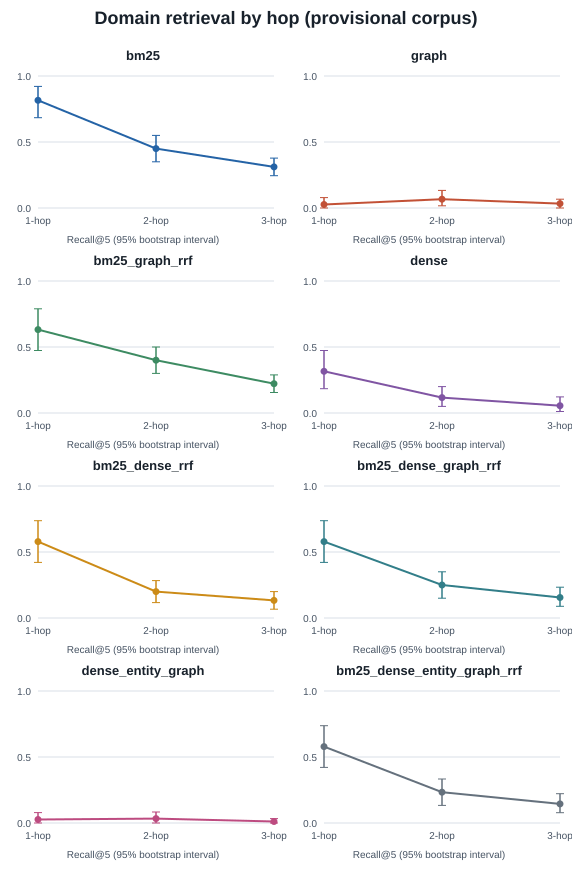
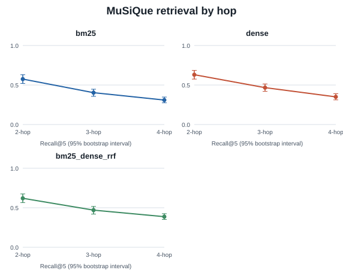

# Hop-split retrieval charts

Generated from the existing public and domain retrieval JSON artifacts by `python eval/build_retrieval_charts.py`. The script only reads `eval/results/` and writes two versioned SVGs here.

## Domain track

Each panel shows supporting-document recall@5 by hop count with the saved 95% bootstrap interval. The domain corpus and graph have not completed relevance, rights, or manual quality review; full-inventory graph extraction and its evaluation are still in progress.

## Public MuSiQue track

The corresponding exact values and sample sizes are in [the generated results table](../eval/results-summary.md). Do not compare absolute values across tracks.
